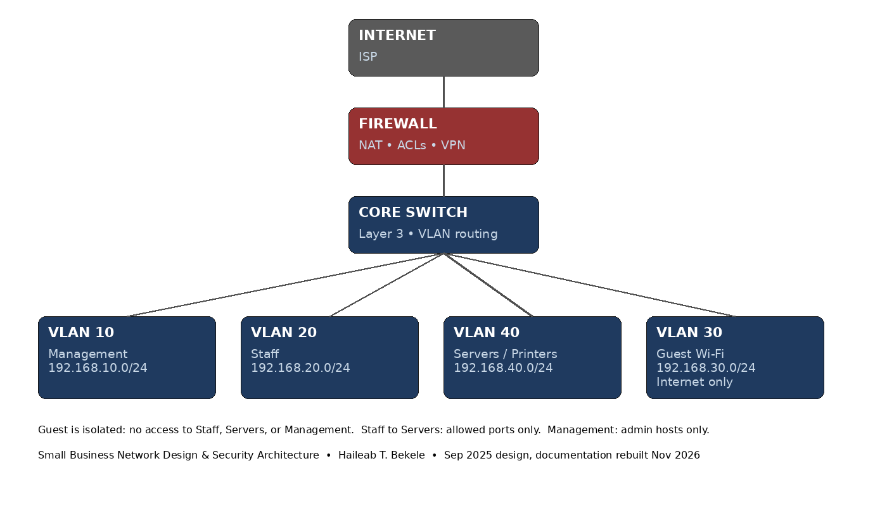

# Small Business Network Design & Security Architecture

**Author:** Haileab T. Bekele
**Project date:** September 2025
**Status:** Coursework design. Documentation rebuilt November 2026 — the original Cisco file was lost with a previous PC, so this is a rebuilt design document, not a recovered original file and not a production deployment.

## What this is
A secure, segmented network design for a generic small business (no client name — coursework design). It covers segmentation, secure connectivity, and reliability, in a form a recruiter or hiring manager can read in five minutes.

## Topology
Internet → Firewall → Core Switch (Layer 3, VLAN routing) → Segmented access

## IP and VLAN plan
| VLAN | Segment | Network | Gateway | Notes |
|---|---|---|---|---|
| 10 | Management | 192.168.10.0/24 | 192.168.10.1 | Admin hosts only |
| 20 | Staff | 192.168.20.0/24 | 192.168.20.1 | Day-to-day workstations |
| 40 | Servers / Printers | 192.168.40.0/24 | 192.168.40.1 | Shared services, limited inbound |
| 30 | Guest Wi-Fi | 192.168.30.0/24 | 192.168.30.1 | Internet only, isolated |

## Segmentation and access rules
- Guest → Internet: allowed. Guest → Staff, Servers, or Management: denied.
- Staff → Servers: allowed on required service ports only, not unrestricted.
- Staff → Guest: denied.
- Management → all segments: admin hosts only, for administration.
- Servers → Internet: limited to updates and required services, not open outbound.

## Secure connectivity
- Guest wireless isolated from the internal network, with a separate SSID and password policy.
- Staff wireless with WPA3 where supported, with a documented fallback to WPA2 where a device cannot support WPA3.
- Remote access only through the firewall VPN, with individual accounts — no shared remote-access account.
- Firewall rules are default-deny, with explicit allows listed above.

## Reliability
- Redundant uplink from the core switch where the site allows it, so a single access-switch link failure does not take down a whole segment.
- Documented configuration backup: export and store the firewall and switch configurations after any change, and test a restore from backup.
- Documented recovery order: Internet / firewall, then core switch, then servers, then staff access, then guest access.
- Simple monitoring: check gateway reachability, DHCP, DNS, and internet access from each VLAN after any change.

## Testing checklist (design validation)
1. From Guest: internet works, internal Staff / Server addresses do not respond.
2. From Staff: required server services work, Management addresses are not reachable except from admin hosts.
3. From Management: admin access works, and a non-admin host cannot reach Management.
4. After a simulated link failure: the affected segment recovers on the redundant path.
5. After a configuration restore: the firewall and switch return to the documented state.

## Packet Tracer build — configs included, genuine .pkt to follow
- `configs/edge-router.txt`, `configs/core-switch.txt`, `configs/access-switch.txt` — complete, paste-ready Cisco IOS configs for the Edge Router (2911), Core Switch (3560, Layer 3), and Access Switches (2960), matching the VLAN, IP, ACL, DHCP, and NAT design above.
- `PACKET_TRACER_BUILD_GUIDE.md` — device list, cabling, paste order, wireless GUI steps, and the 6 tests that must pass before saving.
- No .pkt file is included yet, because Packet Tracer saves in its own encrypted .pkt format with no supported way to generate a valid .pkt outside Packet Tracer, and Packet Tracer is not installed here. Follow the build guide in Packet Tracer, save a genuine .pkt from Packet Tracer, test reopening it once, and then upload that genuine .pkt alongside these files.

## What this does NOT claim
- This is not a production network for a named client, and it does not claim a specific hardware vendor deployment, a live site, or user counts beyond a small-business scale.
- No Cisco Packet Tracer file is included yet, because the original was lost. A simulation file built from this guide should be labelled as a new build from this architecture, not as the original lost file.

## Skills shown
Network design, VLAN segmentation, IP addressing, firewall ACL design, secure wireless and VPN connectivity, reliability and recovery documentation, Wireshark-ready troubleshooting (packet and connectivity checks per segment).
